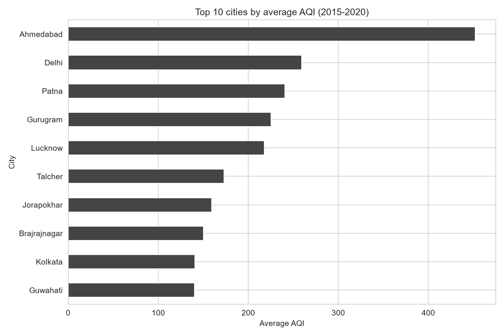
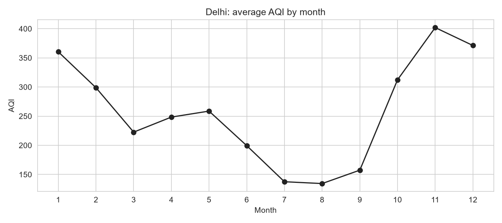
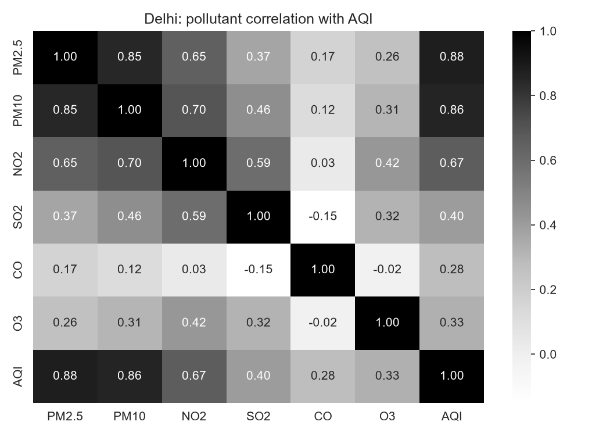
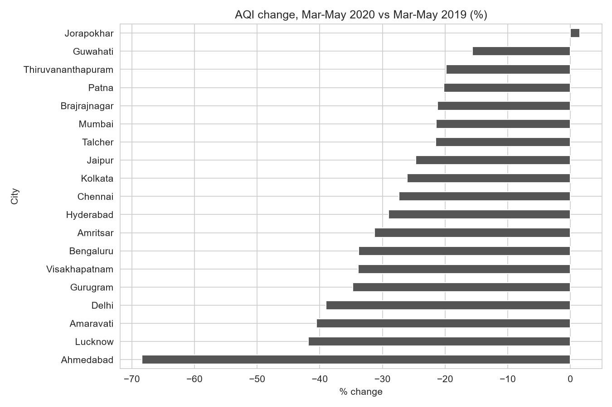

# India Air Quality Analysis (2015-2020)
 
An end-to-end data analysis of daily air quality across 26 Indian cities, with a focus on Delhi. The project covers data cleaning, exploratory analysis, SQL queries, a COVID-19 lockdown impact comparison, and an interactive Streamlit dashboard.
 
**Live demo:** [YOUR-APP.streamlit.app](https://YOUR-APP.streamlit.app)
 
## Why this project
 
Delhi regularly ranks among the most polluted cities in the world. I wanted to understand *when* pollution peaks, *which pollutant* drives it, and whether the 2020 lockdown made a measurable difference, using real data instead of headlines.
 
## Dataset
 
[Air Quality Data in India (2015-2020)](https://www.kaggle.com/datasets/rohanrao/air-quality-data-in-india) from Kaggle, using `city_day.csv`: 29,531 daily records across 26 cities, with pollutant readings (PM2.5, PM10, NO2, SO2, CO, O3 and others) and the AQI.
 
## Tools
 
Python, Pandas, SQL (SQLite), Matplotlib, Seaborn, Plotly, Streamlit
 
## Approach
 
1. **Cleaning:** dropped 4,681 rows with no AQI value (24,850 remain), then filled missing pollutant values with each city's own median. Median was used because pollutant readings are heavily right-skewed, so the mean would be pulled up by extreme days.
2. **Feature engineering:** extracted year and month, and mapped months to seasons (Winter, Summer, Monsoon, Post-monsoon).
3. **Analysis:** city rankings, seasonal and yearly trends, pollutant correlations, AQI category distribution.
4. **SQL:** used `GROUP BY` and `CASE WHEN` queries to count "Poor or worse" days per city and to compute Delhi's PM2.5 by year and season.
5. **Lockdown comparison:** average AQI for March to May 2019 vs March to May 2020, per city.
6. **Dashboard:** Streamlit app with city and year filters.
## Key findings
 
- **Delhi has a strong seasonal pattern.** Average AQI is about 357 in winter versus 143 in monsoon, roughly 2.5x higher. Winter PM2.5 reached 186-236 µg/m³ in most years, against 40-61 in monsoon.
- **PM2.5 and PM10 drive Delhi's AQI.** Correlation with AQI is 0.88 for PM2.5 and 0.86 for PM10, well above NO2 (0.67), SO2 (0.40), O3 (0.33) and CO (0.28).
- **Delhi's air is rarely good.** Only 1.1% of days were "Good". About 65% of days were "Poor", "Very Poor" or "Severe" (27.1%, 26.0% and 12.0%).
- **Delhi has the most bad-air days.** 1,301 days rated Poor or worse, ahead of Ahmedabad (1,092) and Lucknow (935).
- **Lockdown impact.** Comparing March to May 2020 with the same months in 2019, Delhi's AQI fell from about 218 to 133 (-39%), and the average drop across cities was about 29%.
## Limitations
 
- **Lockdown is not the only factor.** Weather, rainfall and seasonal variation also change between years, so the drop cannot be attributed to the lockdown alone. This is a comparison, not a causal analysis.
- **Ahmedabad looks like a data outlier.** Its average AQI (452) is above the "Severe" threshold and its lockdown drop (-68%) is unusually large, which suggests sensor or reporting issues. I did not use it as the basis for any conclusion.
- **2020 is a partial year.** The data ends in mid-2020, so yearly averages for 2020 are not directly comparable with full years.
- **Missing values were imputed.** City-wise median filling keeps rows usable but can understate variability, especially for columns with many gaps.
## Charts
 




 
## Project structure
 
```
AQI-Analysis-India/
  analysis.py        # cleaning, EDA, SQL queries, chart generation
  app.py             # Streamlit dashboard
  city_day.csv       # dataset
  charts/            # saved charts
  requirements.txt
```
 
## Run locally
 
```bash
git clone https://github.com/adityasharmass12/AQI-Analysis-India.git
cd AQI-Analysis-India
pip install -r requirements.txt
pip install matplotlib seaborn   # only needed for analysis.py
 
python analysis.py        # prints findings and saves charts
streamlit run app.py      # launches the dashboard
```
 
## Author
 
Aditya Sharma, CSE student at Delhi Technical Campus.
[GitHub](https://github.com/adityasharmass12)
 
